

|[:skull:ISSUE](https://github.com/frankyhub/Giesela/issues?q=is%3Aissue)|[:speech_balloon: Forum /Discussion](https://github.com/frankyhub/Giesela/discussions)|[:grey_question:WiKi](https://github.com/frankyhub/Giesela/wiki)||
|--|--|--|--|
| | | | |
<a href="https://github.com/frankyhub/Giesela/issues">|<a href="https://github.com/frankyhub/Giesela/discussions">|<a href="https://github.com/frankyhub/Giesela/6eleases">||
|| <a href="https://github.com/frankyhub/Giesela/pulse" alt="Activity">| <a href="https://github.com/frankyhub/Giesela/graphs/traffic">  |<a href="https://github.com/frankyhub?tab=stars"> ||

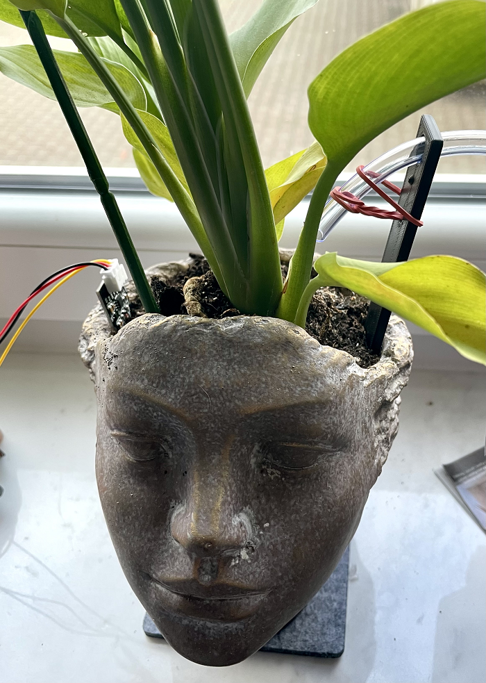 
   

## Story

Hey, ich bin Giesela, ein automatisches Bewässerungssystem für drei unterschiedliche Pflanzentypen. Drei Sensoren erfassen die Feuchte der Pflanzenerde in den Blumentöpfen und steuern die Wasserzufuhr für die Pflanzenbewässerung. Sollte im Wassertank zu wenig Wasser sein, erkennt das der "Trockenschutzsensor" und die Füllstands-LED leuchtet. Gleichzeitig schalten die drei Pumpen aus, bis ausreichend Gießwasser nachgefüllt wurde.
Entsteht aus irgendeinem Grund zu viel Nässe in den Blumentöpfen, schalten zur Sicherheit die drei Pumpen ebenfalls ab, die Überlauf-LED leuchtet und der Buzzer ertönt.
An einem WEB-Server werden die drei Feuchtewerte der Pflanzentöpfe mit Analoganzeigen dargestellt.
Für die Inbetriebnahme steht ein WLAN-Manager zur Eingabe der WLAN-Zugangsdaten zur Verfügung. Nach dem ersten anlegen der Versorgungsspannung wird bei den WLAN-Netzwerkeinstellungen des Handys oder Tablets das Netzwerk "Giesela" ausgewählt und in der Adressleiste des Browsers die IP-Adresse 192.168.4.1 eingegeben. Mit dieser IP-Adresse startet er WLAN-Manager für die Eingabe und dem Speichern der WLAN-Zugangsdaten. Nach der Eingabe und dem Speichern der SSID und des WLAN-Passwortes startet der Micro Controller neu und baut die WLAN-Verbindung auf. Jetzt ist das Bewässerungssystem und der WEB-Server aktiv.

Giesela Pflanzenbewässerung

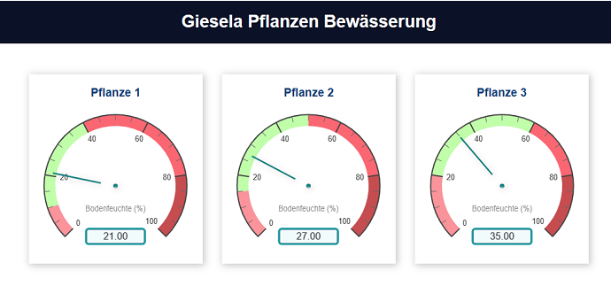 
   

Giesela WEB-Server

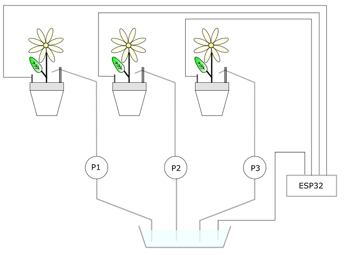 
   

Giesela Technologie-Schema

---

## Hardware
Die Stückliste für Giesela:

+ 1 x ESP32
+ 1 x ESP32-Shield
+ 2 x Buchsenleisten
+ 2 x Stiftleisten
+ 1 x Schalter
+ 1 x Buzzer
+ 5 x 1,2 kOhm
+ 5 x LED rot
+ 5 x Relais
+ 3 x Pumpen
+ 3 x Bodensensoren
+ 1 x Füllstandssensor
+ 1 x Litze
+ 1 x 9V Netzteil
+ 1 x Gelasertes Gehäuse(4mm Sperrholz 600x300)

---

## Aufbau und Montage
Der Aufbau und die Montage des Bewässerungs-Systems ist in mehrere Schritte unterteilt.

Schritt 1: Das Gehäuse
+ Erstelle auf Boxes.PY eine "BasedBox" mit den Abmessungen x=110, y=100 und h=100.
+ Füge in die erstellte SVG-Grafik die Löcher für die LEDs und den Schalter ein
+ Füge in die erstellte SVG-Grafik die Ausgänge für die Sensoren und Pumpen ein
+ Füge in die erstellte SVG-Grafik den Ausschnitt für die ESP32 Spannungsversorgung ein
+ Schneide das Gehäuse mit dem Lasercutter aus
+ Montiere die Gehäuseteile zusammen (noch nicht verkleben)

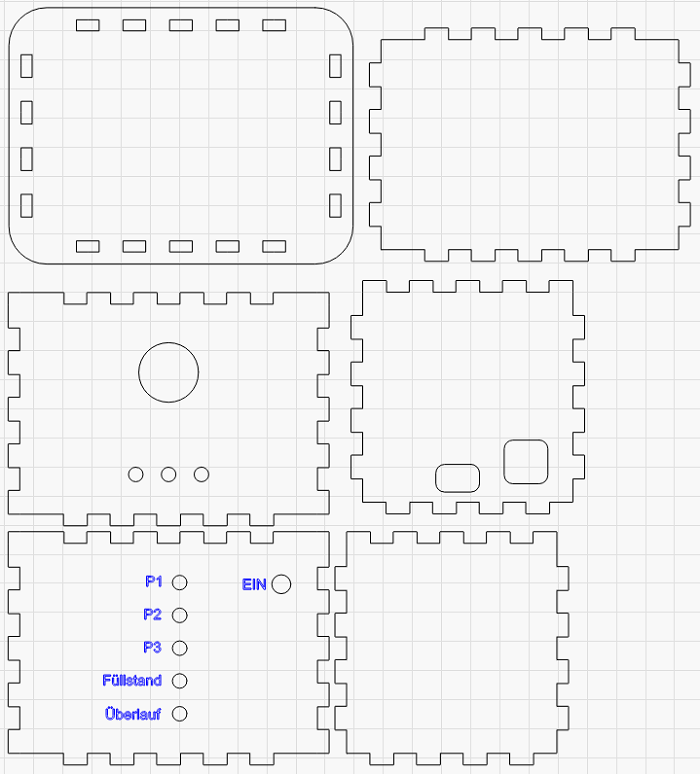 
   

Giesela Gehäuse.png

---

Schritt 2: 3D-Druck mit Tinkercad
+ Zeichne und drucke 4 Platinen Füße für den ESP32, D=5mm x 5mm
+ Klebe die Füße auf die Unterseite des ESP32-Shields
+ Zeichne und drucke 3 Schlauchhalter

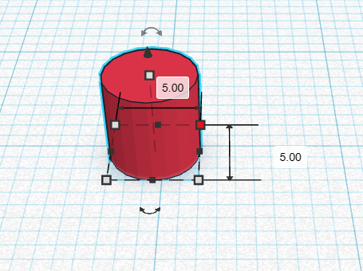 
   

5mm Spacer

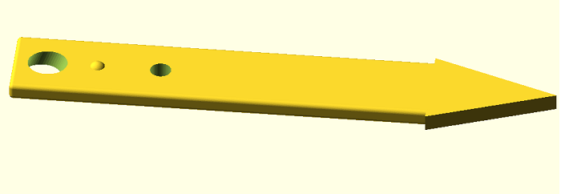 
   

Schlauchhalter

---

Schritt 3: Verdrahtung und Lötarbeiten
+ Bestücke das ESP32-Shield mit den Buchsenleisten und den Vorwiderständen für die LEDs
+ Biege an einem Ende der Widerstände und am +Pol der LEDs eine Öse

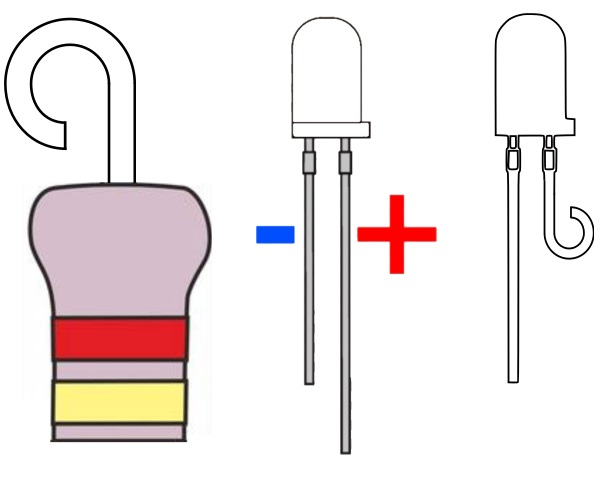 
   

LED Öse

Führe Anschlussdrähte für die Widerstände und der LEDs durch die Öse und Löte sie an

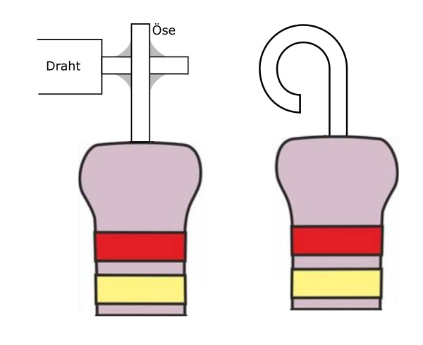 
   

LED Lötstelle

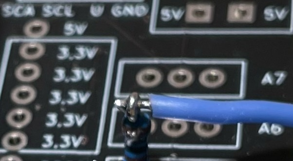 
   

Platine

Verdrahte das Shield, die LEDs, die Sensoren, die Pumpen, den Buzzer und die Relais nach den Verdrahtungsplan

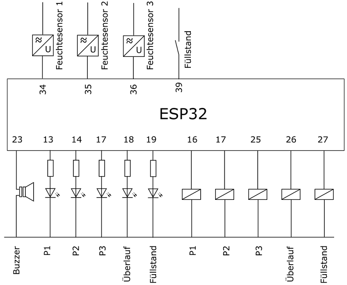 
   

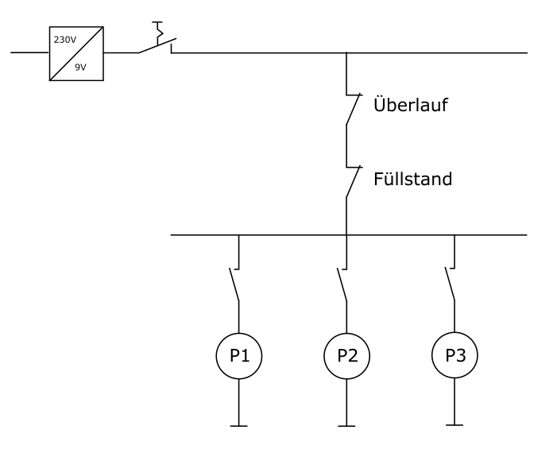 
   

---

Schritt 4: Inbetriebnahme
+ Kontrolliere alle Verbindungen
+ Lade das Programm in den ESP32
+ Das Programm befindet sich auf deinen Laptop unter Nextcloud/Giesela
+ Versorge Giesela mit Spannung
+ Gib über den WLAN-Manager die WLAN-Zugangsdaten ein
+ Teste den WEB-Server
+ Simuliere die Feuchtesensoren mit einem Poti
+ Wenn der WEB-Server funktioniert, schließe die Feuchtesensoren an
+ Montiere alle Bauteile in das Gehäuse
+ Teste die Funktion der Pumpen und der Alarmmeldungen
+ Beobachte die Gießfunktion und achte darauf, dass kein Wasser unkontrolliert austritt

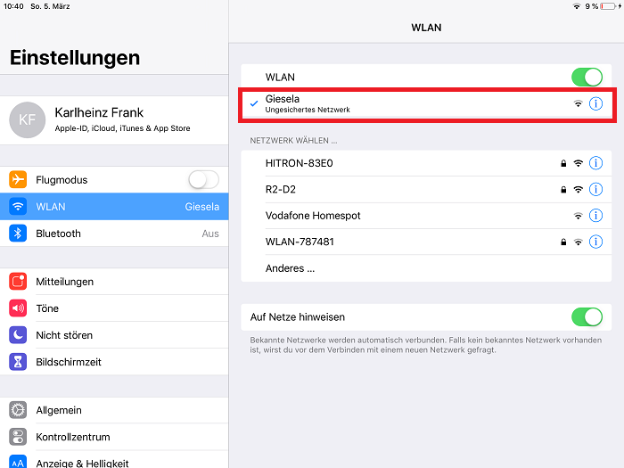 
   

Giesela im WLAN-Netzwerk auswählen

 
   

Die WLAN-Zugangsdaten im WLAN-Manager eingeben und speichern.

---

   
<ol class="breadcrumb" style="border-top: 2px solid black;border-bottom:2px solid black; height: 45px; width: 900px;"> 
<a href="#oben">nach oben</a>
</ol>

  

---
